# 🛡️ Awesome Managed Data Detection & Response (MDDR) 🚀

  
  
  
  
  
  

  <b>A curated list of elite Managed Data Detection and Response (MDDR) &amp; Managed Detection and Response (MDR) platforms, autonomous AI SOCs, and open-source cybersecurity frameworks for 24/7 continuous threat monitoring, automated containment, and forensic digital investigation.</b>

  🌟 <i>Star this repository to stay ahead of modern cloud data protection, zero-day threat defense, and ransomware incident recovery!</i> 🌟

---

## 🧭 Table of Contents 📑

- [🌐 Sector Overview & Market Dynamics](#-sector-overview--market-dynamics)
- [🏢 SaaS & Hosted Commercial Platforms](#-saas--hosted-commercial-platforms)
- [💻 Open-Source Software & Toolkits](#-open-source-software--toolkits)
- [📊 Feature & Response Comparison](#-feature--response-comparison)
- [🤝 Contributing Guidelines](#-contributing-guidelines)
- [💖 Support & Sponsorship](#-support--sponsorship)
- [📈 Star History](#-star-history)
- [📄 License](#-license)

---

## 🌐 Sector Overview & Market Dynamics 📈

The global Managed Detection and Response (MDR) market is valued at approximately **$5.0B – $6.2B** and is projected to expand to **$13.0B – $17.6B by the early 2030s** at an estimated CAGR of 17% – 23.5%, driven by the acute cybersecurity talent deficit, escalating ransomware campaigns, and stringent enterprise regulatory compliance requirements. The sector is **highly fragmented and intensely competitive** across 600+ providers globally rather than a winner-take-all monopoly, spanning specialized pure-play MDR vendors, hyperscale cloud/XDR platform providers, and managed SOC service integrators catering to diverse organizational telemetry stacks and vertical-specific compliance needs.

---

## 🏢 SaaS & Hosted Commercial Platforms ☁️

The following commercial, cloud-hosted MDDR and MDR platforms deliver turnkey 24/7 human analyst oversight, agentic AI triage, telemetry ingestion, and proactive threat containment. Sorted in descending order by enterprise scale (market capitalization / valuation):

| Platform / Vendor | Company Scale (Valuation / Revenue) 🏢 | Pricing (Specific Starting Tiers) 💵 | Free Tier / Trial Limit ⏱️ | Core Focus & Autonomous Capability 🎯 |
| :--- | :--- | :--- | :--- | :--- |
| **CrowdStrike Falcon Complete** | **~$232.0B Market Cap** (~$4.81B TTM Revenue) | Starting tier **Falcon Go at $59.99/device/year** ($7.99/device/month, up to 100 devices); **Falcon Pro at $99.99/device/year**; enterprise **Falcon Complete MDR requires custom tier scoping** | **15-Day Free Trial** (Includes Falcon Prevent NGAV, Device Control, and Express Support; no credit card required) | Agentic MDR with deterministic automation, AI agents, and 24/7 human oversight delivering median **1-minute time to containment (MTTC)**. |
| **SentinelOne Vigilance Respond** | **~$8.0B Market Cap** (~$1.10B TTM Revenue) | Core Singularity platform begins at **~$30 – $40/endpoint/year** (Standard Core/Control list baseline for small fleets); **Vigilance MDR service add-on starts at custom tiered minimums** | **30-Day Free Trial** (Full evaluation of core Singularity endpoint protection platform via partner/sales portal) | Layered Singularity EDR/XDR defense; Respond Pro adds digital forensic reporting, malware reverse engineering, and dedicated prepaid incident response retainer. |
| **Arctic Wolf Aurora MDR** | **~$4.3B Valuation** (~$430M+ ARR) | AWS Marketplace public listing starts at **$44,000/year base tier** (Covers up to 100 users/endpoints on a 12-month contract; ~$36/user/month) | **No Free Trial** (0 days; requires scheduled Concierge Security posture review and interactive live SOC architecture demonstration) | Concierge Security Team model with proprietary Aurora Agentic SOC and 200+ telemetry integrations reducing attack frequency by up to 90%. |
| **ReliaQuest GreyMatter** | **~$3.4B Valuation** (~$300M – $400M ARR) | Enterprise multi-telemetry agreements starting at **enterprise commitments typically exceeding $80,000 – $100,000+/year** based on data pipeline throughput | **No Free Trial** (0 days; custom Proof of Value / interactive production architecture evaluation) | Open XDR SecOps platform with six autonomous AI teammate personas handling 100% of alert investigations with average 4.48-minute containment. |
| **Druva Managed Data Detection and Response** | **~$2.0B Valuation** (~$200M+ ARR) | Platform consumption tier begins at **~$2.50 – $3.00/user/month** for endpoints or **$6.00 – $8.00/TB/month deduplicated backup data** (MDDR is included at $0 extra charge for core enterprise cloud platform customers) | **30-Day Free Trial** (Includes up to 1 TB of cloud backup data, automated ransomware anomaly detection, and full cloud management console access) | Tailored backup data threat monitoring, catching snapshot sabotage, mass deletion, and suspicious Microsoft 365/Google Workspace/AWS activity with guided recovery. |
| **Expel MDR** | **~$1.0B Valuation** (~$120M – $145M ARR) | Entry-level **Starter tier** begins through select partner channels; median enterprise spend ranges from **~$150,000/year** across multi-workload deployments | **No Free Trial** (0 days; bespoke multi-day Proof of Value connecting directly to production cloud/SIEM infrastructure) | Vendor-agnostic, transparent BYO-tech MDR powered by the Ruxie AI engine with median 14-minute MTTR and live analyst workbench visibility. |
| **Rapid7 Managed Threat Complete** | **~$980M Market Cap** (~$800M TTM Revenue) | Public marketplace tier starts at **$73,000/year** (Covering an initial deployment tier of ~300 enterprise assets, including servers and endpoints) | **14-Day Free Trial** (Full access to underlying InsightIDR cloud SIEM, automated log search, and behavioral vulnerability analytics) | MXDR bundled with unlimited vulnerability risk management and embedded digital forensics / incident response retainers without third-party handoffs. |

---

## 💻 Open-Source Software & Toolkits 🛠️

While turnkey 24/7 human analyst operations require organizational personnel or MSP partnerships, these battle-tested open-source projects provide the essential technical telemetry pipelines, SIEM correlation engines, threat intelligence sharing, and incident response frameworks for building modern detection and response capabilities.

Sorted in descending order by GitHub stargazers:

### 1. [Wazuh](https://github.com/wazuh/wazuh) 
* **Stack:** C / C++ / Python / OpenSearch | **License:** GPL-2.0 📜
* **Repository:** [wazuh/wazuh](https://github.com/wazuh/wazuh) 🔗
* **Description:** Unified open-source XDR and SIEM platform providing endpoint security agents, File Integrity Monitoring (FIM), CVE vulnerability auditing, active remediation, and MITRE ATT&CK telemetry mapping.
* **Role in MDDR:** Serves as the primary host-level sensor and telemetry aggregator for detection across physical endpoints, virtual instances, and containerized clusters.

### 2. [Sigma](https://github.com/SigmaHQ/sigma) 
* **Stack:** Python / YAML | **License:** Detection Rules (DRL 1.1) / Tools (LGPL-2.1) 📜
* **Repository:** [SigmaHQ/sigma](https://github.com/SigmaHQ/sigma) 🔗
* **Description:** Generic and open signature format for SIEM systems, allowing security analysts to write vendor-agnostic detection rules and convert them dynamically into queries for Wazuh, Splunk, Elastic, and Sentinel.
* **Role in MDDR:** Powers standardized threat detection logic across multi-vendor log sources without vendor lock-in.

### 3. [OpenCTI](https://github.com/OpenCTI-Platform/opencti) 
* **Stack:** TypeScript / GraphQL / Python / Docker | **License:** Apache-2.0 📜
* **Repository:** [OpenCTI-Platform/opencti](https://github.com/OpenCTI-Platform/opencti) 🔗
* **Description:** Unified Cyber Threat Intelligence (CTI) platform engineered to structure, store, organize, and visualize tactical and strategic threat intelligence observables, TTPs, and threat actor campaigns.
* **Role in MDDR:** Enriches raw security alerts with global threat intelligence feeds to prioritize high-confidence intrusions.

### 4. [Zeek](https://github.com/zeek/zeek) 
* **Stack:** C++ / Python / Zeek Script | **License:** BSD-3-Clause 📜
* **Repository:** [zeek/zeek](https://github.com/zeek/zeek) 🔗
* **Description:** Powerful network security monitoring and traffic analysis framework that inspects protocols at depth, transforms raw packets into structured event logs, and uncovers command-and-control communication channels.
* **Role in MDDR:** Delivers critical network-layer visibility and behavioral telemetry to identify data exfiltration attempts.

### 5. [MISP (Malware Information Sharing Platform)](https://github.com/MISP/MISP) 
* **Stack:** PHP / Python / MySQL | **License:** GPL-3.0 📜
* **Repository:** [MISP/MISP](https://github.com/MISP/MISP) 🔗
* **Description:** Open-source software solution for collecting, storing, distributing, and sharing cyber security indicators of compromise (IOCs) and threat intelligence between CSIRTs and financial circles.
* **Role in MDDR:** Facilitates automated IOC sharing and matching against inbound organizational telemetry streams.

### 6. [OSSEC HIDS](https://github.com/ossec/ossec-hids) 
* **Stack:** C / Shell | **License:** GPL-2.0 📜
* **Repository:** [ossec/ossec-hids](https://github.com/ossec/ossec-hids) 🔗
* **Description:** Lightweight host-based intrusion detection system offering comprehensive log analysis, file integrity verification, rootkit detection, and real-time active response alerts.
* **Role in MDDR:** Provides reliable host audit tracking and tampering detection for mission-critical bare-metal servers.

### 7. [Security Onion](https://github.com/Security-Onion-Solutions/securityonion) 
* **Stack:** Linux / Python / Bash / Docker | **License:** AGPL-3.0 / Elastic License 📜
* **Repository:** [Security-Onion-Solutions/securityonion](https://github.com/Security-Onion-Solutions/securityonion) 🔗
* **Description:** Turnkey Linux distribution designed for threat hunting, enterprise security monitoring, and log management, bundling Zeek, Suricata, Wazuh, and the Elastic stack.
* **Role in MDDR:** Acts as an all-in-one standalone open-source SOC sensor array for distributed network and host monitoring.

### 8. [Velociraptor](https://github.com/velocidex/velociraptor) 
* **Stack:** Go / VQL (Velociraptor Query Language) | **License:** AGPL-3.0 📜
* **Repository:** [velocidex/velociraptor](https://github.com/velocidex/velociraptor) 🔗
* **Description:** Advanced endpoint visibility, digital forensics, and incident response (DFIR) platform allowing security teams to query thousands of remote systems within seconds using VQL queries.
* **Role in MDDR:** Powers deep live forensic triage, memory dump retrieval, and rapid artifact collection during an ongoing breach.

### 9. [TheHive](https://github.com/TheHive-Project/TheHive) 
* **Stack:** Scala / Angular / Elasticsearch | **License:** AGPL-3.0 📜
* **Repository:** [TheHive-Project/TheHive](https://github.com/TheHive-Project/TheHive) 🔗
* **Description:** Scalable, open-source Security Incident Response Platform designed to streamline case management, evidence collaboration, task assignment, and timeline tracking for SOC and CSIRT analysts.
* **Role in MDDR:** Acts as the central case ticketing and incident investigation cockpit for analysts handling triage.

### 10. [Shuffle](https://github.com/shuffle/shuffle) 
* **Stack:** Go / Python / JavaScript | **License:** AGPL-3.0 📜
* **Repository:** [shuffle/shuffle](https://github.com/shuffle/shuffle) 🔗
* **Description:** Open-source Security Orchestration, Automation, and Response (SOAR) platform featuring an intuitive visual workflow builder, API connectors, and automated playbook triggers.
* **Role in MDDR:** Automates containment workflows, such as isolating compromised machines, revoking OAuth tokens, or blocking attacker IPs.

### 11. [Cortex](https://github.com/TheHive-Project/Cortex) 
* **Stack:** Python / Play Framework | **License:** AGPL-3.0 📜
* **Repository:** [TheHive-Project/Cortex](https://github.com/TheHive-Project/Cortex) 🔗
* **Description:** Observable analysis and active response engine complementing TheHive by running automated analyzers (VirusTotal, Shodan, AbuseIPDB, URLScan) and active responders.
* **Role in MDDR:** Instantly extracts and enriches IOCs submitted by SIEM alerts without manual analyst intervention.

---

## 📊 Feature & Response Comparison 🔍

| Platform / Tool | Delivery Model | Primary Telemetry Focus | MTTC / Containment Speed | Retainer / Dedicated IR | Self-Hosted Option | Best Target Use Case |
| :--- | :--- | :--- | :--- | :--- | :--- | :--- |
| **CrowdStrike Falcon Complete** | Managed SaaS | Full Enterprise Endpoint, Identity & Cloud | **~1 minute MTTC** | ✅ Included remediation | ❌ | High-velocity AI containment + governance |
| **SentinelOne Vigilance** | Managed SaaS | Autonomous EDR / XDR Workloads | 1 – 4 hours | ✅ Respond Pro Retainer | ❌ | Deep digital forensic inspection & reverse engineering |
| **Arctic Wolf Aurora** | Managed SaaS | Network, Host, Cloud & Identity | Minutes (Guided Concierge) | ✅ Concierge Security | ❌ | Turnkey risk posture reduction & compliance |
| **ReliaQuest GreyMatter** | Managed SaaS / Platform | Universal Open XDR (300+ integrations) | **4.48 minutes MTTC** | ✅ AI Analyst Teammates | ❌ | Large enterprise multi-SIEM orchestration |
| **Druva MDDR** | Managed SaaS | Backup Sets, Snapshots & Cloud Stores | Rapid playbook triage | ✅ Included with Druva | ❌ | Immutable backup defense & ransomware data recovery |
| **Expel MDR** | Managed SaaS | Multi-Cloud, BYO-EDR & SaaS | **14 minutes MTTR** | ✅ Analyst-executed | ❌ | 100% transparent SOC workbench with existing tools |
| **Rapid7 Managed Threat** | Managed SaaS | Asset Telemetry & Vulnerability Scanning | Minutes (Embedded DFIR) | ✅ Unlimited IR Retainer | ❌ | Integrated vulnerability management + MDR |
| **Wazuh** | Open Source | Host FIM, System Calls & Logs | Automated Active Response | ❌ (Internal SOC / MSP) | ✅ | Comprehensive on-premise & cloud SIEM foundation |
| **Velociraptor** | Open Source | Live Memory, Filesystem & VQL Artifacts | Seconds (Query runtime) | ❌ (Internal DFIR) | ✅ | Fleet-wide digital forensics & threat hunting |
| **TheHive & Cortex** | Open Source | Security Cases & Threat Observables | Configurable Playbooks | ❌ (Internal SOC / MSP) | ✅ | Scalable incident case management & enrichment |
| **Shuffle** | Open Source | Multi-Tool Webhooks & API Workflows | Sub-second Execution | ❌ (Internal Automation) | ✅ | Open-source SOAR automation & automated playbooks |

---

## 🤝 Contributing Guidelines 💡

Contributions are warmly welcomed! If you wish to suggest an open-source detection framework, a cutting-edge autonomous SecOps engine, or updates to commercial platform capabilities:

1. 🍴 Fork the repository.
2. 🌿 Create your feature branch (`git checkout -b feature/new-mddr-tool`).
3. 📝 Follow the existing table and format conventions. Provide verified starting tier pricing, explicit trial limits, and exact GitHub repository links.
4. 💾 Commit your changes (`git commit -m 'feat: add new detection platform'`).
5. 🚀 Push to the branch (`git push origin feature/new-mddr-tool`).
6. 📬 Submit a Pull Request.

Please verify that all submitted open-source repositories are actively maintained and licensed under recognized OSI-compliant licenses.

---

## 💖 Support & Sponsorship ☕

If you found this curated list helpful for evaluating detection and response platforms, building your SOC strategy, or benchmarking enterprise security tools, consider supporting the continuous maintenance and curation of open cybersecurity resources:

**🙏 Thank you for your support! Every star, fork, and share helps empower the open security community!**

⭐ **Star the repo** &nbsp;•&nbsp; 🍴 **Fork the project** &nbsp;•&nbsp; 📢 **Share with your SecOps team** &nbsp;•&nbsp; ☕ **[Buy a coffee via GitHub Sponsors](https://github.com/sponsors/ishandutta2007)**

---

## 📈 Star History

---

## 📄 License ⚖️

This curated compilation is released under the creative commons [CC0 1.0 Universal (Public Domain Dedication)](https://creativecommons.org/publicdomain/zero/1.0/). Referenced commercial brands, trademarks, and open-source projects remain property of their respective owners and copyright holders.

---

  <b>Built with ❤️ for the global cybersecurity and threat hunting community.</b>

